# LustTermina（ラストテルミナ）

**Windows 向けのターミナルエミュレータ。** 複数のシェルを縦タブで並べて使えて、タブごとに色分けでき、よく使う作業環境を「プリセット」として保存して起動時や新規タブから呼び出せる。Rust + egui 製で軽快に動く。

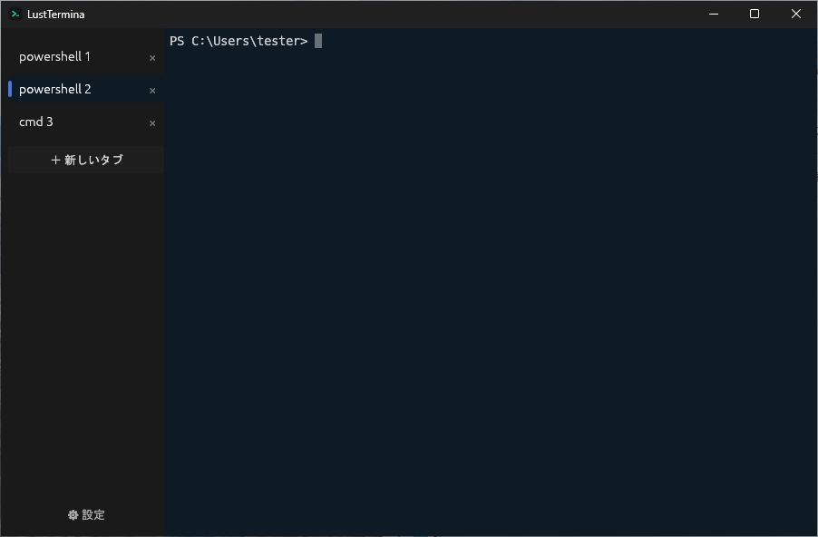

## できること

- **縦タブで並行作業** — PowerShell やコマンドプロンプトなど複数のシェルを 1 ウィンドウにまとめられる。タブはドラッグで並べ替え、ダブルクリックで改名。
- **誤操作で落とさない** — タブを閉じるときも、ウィンドウごと終了するときも確認ダイアログを挟む。終了確認はタイトルバーの ×・**Alt+F4**・タスクバーからの「閉じる」のいずれでも出るので、クリック 1 回で実行中のシェルが全部消えることがない。
- **閉じても裏で動かせる** — 終了確認で「裏で動かす」を選ぶと、ウィンドウだけ消えてシェルはそのまま動き続け、通知領域（タスクトレイ）に常駐する。アイコンの左クリック、または右クリック →「ウィンドウを表示」で戻る。長時間走らせているコマンドを、窓を閉じたい／閉じてしまったせいで落とさずに済む。
- **タブごとに色分け** — タブ単位で背景色・アクセントカラーを設定。「本番用は赤」「ローカルは青」のように一目で見分けられる。
- **プリセット（型）** — よく使うタブ構成（名前・シェル・作業フォルダ・色・起動コマンド）を「プリセット」として保存・複製できる。起動タブや新規タブ（＋）から選ぶと、その型からタブを実体化する。名前は一意（重複・空は警告表示）。
- **起動タブ** — 起動時に開くタブを並べておくと、次回から自動でその環境が開く。各行は「マニュアル」（その場で定義）／「プリセット参照」を切り替えられ、参照が解決できないときはタブ名に警告印（⚠）を付けて知らせる。
- **Explorer から直接開く** — フォルダ（またはフォルダ内の空白）を右クリック →「LustTermina で開く」で、そのフォルダをタブで開ける。既に起動していれば新しいタブとして追加される。インストール時に登録される。
- **コマンドラインで操作** — `ltm --tab --cwd <dir> --cmd <コマンド>` で、起動済みの窓に外から新しいタブを追加できる（インストール時に PATH 登録＋短い別名 `ltm`）。スクリプトやツールから作業環境を組み立てるのに使える。詳しくは[コマンドラインから使う](#コマンドラインから使う)。
- **スクリプトを右クリックで実行** — `.ps1` / `.bat` / `.cmd` を右クリック →「LustTermina で実行」で、そのファイルのあるフォルダを作業フォルダにして実行。**正常終了（終了コード 0）ならタブは自動で閉じ、失敗（非 0）なら出力を残したまま開いたまま**になる。`.ps1` は「プログラムから開く」の一覧にも LustTermina が並ぶ（候補に出るだけで、既定のアプリは変更しない）。
- **日本語入力・表示に対応** — IME での日本語入力、日本語の表示どちらも OK。
- **マウスで選択 → コピー** — ドラッグで範囲選択して `Ctrl+C` でコピー、`Ctrl+V` で貼り付け。
- **スクロールバック** — マウスホイールで過去の出力（最大 1 万行）を遡れる。入力すると最新位置へ戻る。
- **設定は画面から** — 既定のシェル・作業フォルダ・テーマ・タブパネルの左右配置を GUI で変更。変更内容はファイルに保存され、次回も引き継がれる。
- **見た目** — シェルの種類ごとにアイコンを表示。ウィンドウ／タスクバーにも独自アイコン。

## スクリーンショット

**タブごとに色分け** — 環境ごとに背景色・アクセントカラーを割り当てて見分けられます。

| | |
|:--:|:--:|
| 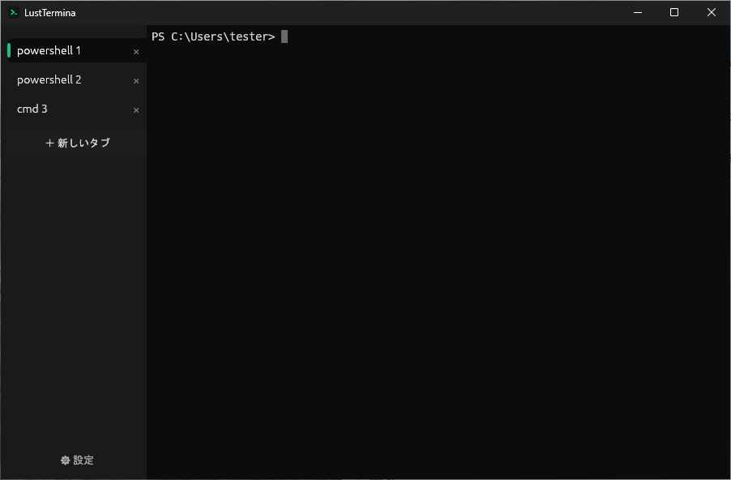 | 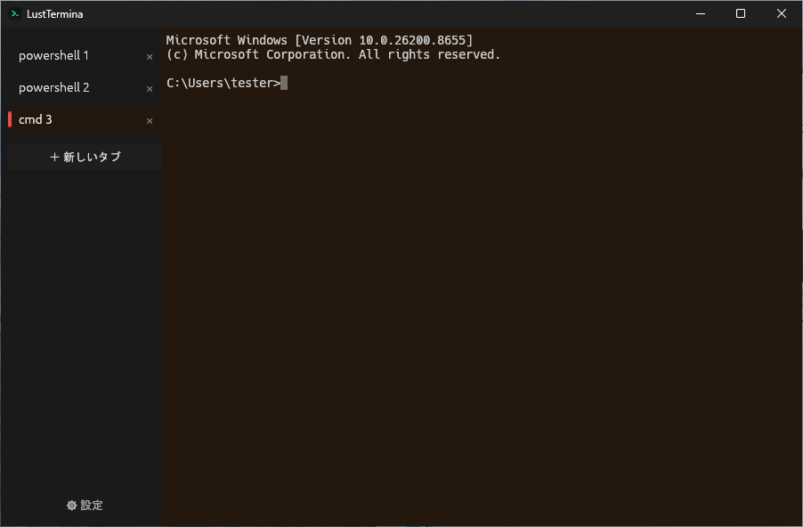 |

**タブパネルは左右どちらにも** — タブの列を好みの側に配置できます。

| | |
|:--:|:--:|
| 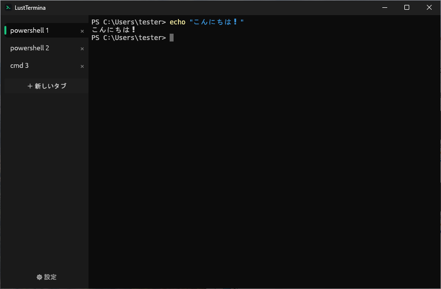 | 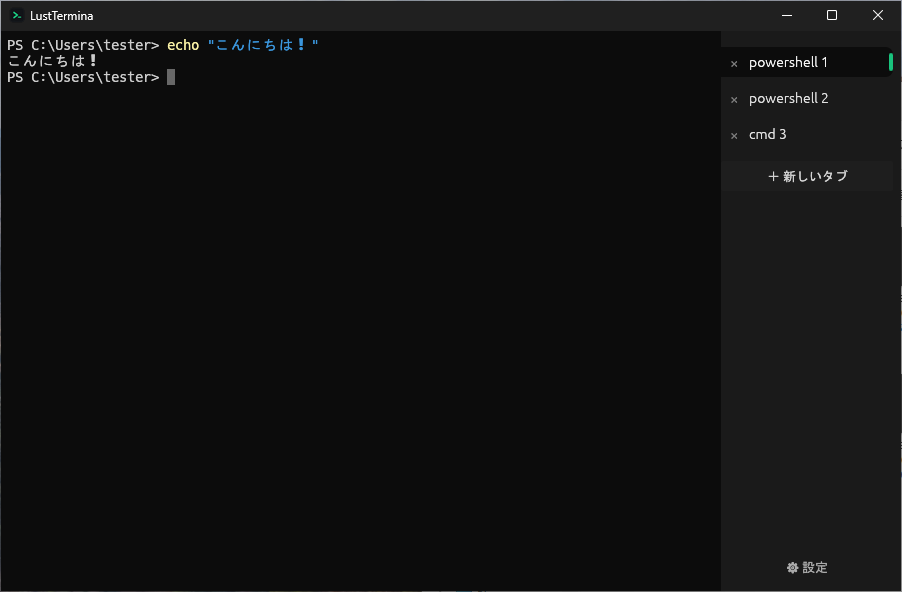 |

**色の設定 ／ 対応シェル** — 色はパレットから選択（「起動タブに追加」で起動構成にも保存）。対応シェルは PowerShell 7・Windows PowerShell・コマンドプロンプト・VS Developer・Git Bash・WSL をアイコン付きで選べます（一覧に出るのは実際に導入済みのシェルです）。

| | |
|:--:|:--:|
| 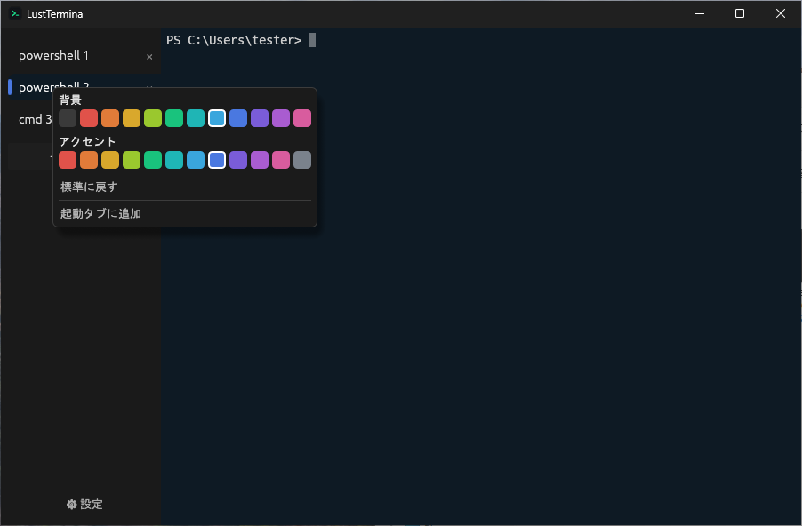 | 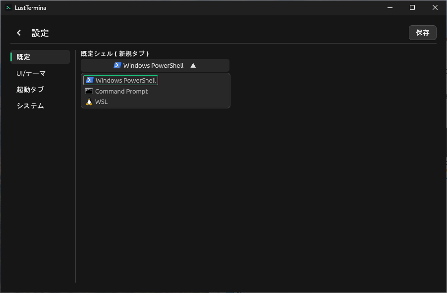 |

**プリセット／起動タブの編集** — 設定の「プリセット」タブで、再利用できるタブ定義（型）を追加・複製・並べ替えできます。「起動タブ」タブでは起動時に開くタブを並べ、各行を「マニュアル」（その場で定義）か「プリセット参照」に切り替えられます。「現在のタブ構成を抜き出す」で、今開いているタブをそのまま起動構成に保存することもできます。

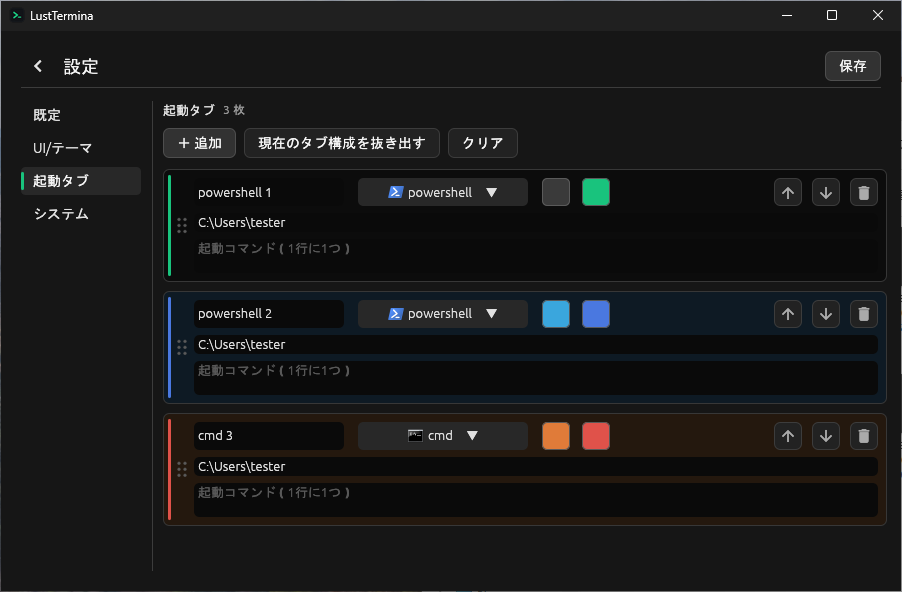

**日本語の表示・入力にも対応** — IME での日本語入力、日本語の表示どちらにも対応しています。


**システム設定** — 現在のバージョン、設定データの管理（データフォルダを開く／初期化）、アンインストールをまとめています。

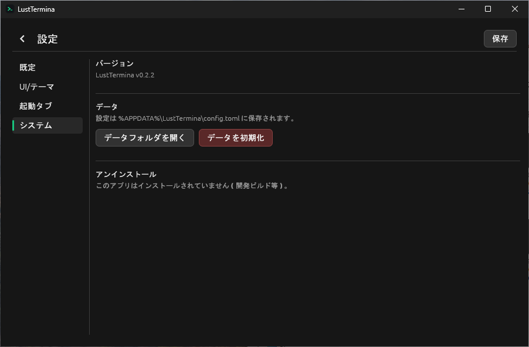

**インストーラ** — 配布 exe を起動すると、導入先（このユーザー専用／PC 全体）を選んでインストールできます。導入済みの場合は現在の版を検出して「更新／再インストール」を出し分けます。

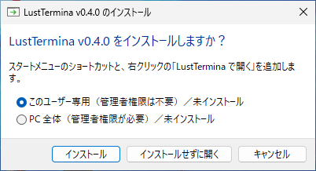

## 動作環境

- Windows 10 / 11
- ビルドする場合は [Rust ツールチェイン](https://www.rust-lang.org/tools/install)

## ダウンロード

[Releases](https://github.com/Capsicum0907/LustTermina/releases) からビルド済みの exe を入手できます（インストール不要・単一ファイル）。

### 初回起動時の警告（SmartScreen）について

ダウンロードした exe は**コード署名していない**ため、初回起動時に Microsoft Defender SmartScreen が

> Windows によって PC が保護されました

と警告を出すことがあります。これは「署名が無く、まだ実行実績の少ない」アプリに対する Windows の既定の挙動で、アプリの中身を危険と判定しているわけではありません。

起動する手順：

1. 警告ダイアログの **「詳細情報」** をクリック
2. 下に現れる **「実行」** ボタンを押す

または、ダウンロードした `.exe` を **右クリック → プロパティ → 全般タブ下部の「ブロックの解除」にチェック → OK** しておくと、以降は警告なしで起動できます。

気になる場合は、下の「使い方」からソースをビルドしてください（自分でビルドした exe にはこの警告は出ません）。

## 使い方

リポジトリを取得してそのまま起動：

```sh
git clone https://github.com/Capsicum0907/LustTermina.git
cd LustTermina
cargo run
```

（初回は依存クレートのコンパイルで数分かかります。以降は数秒。）

**日常使い（ダブルクリックで起動したい場合）：**

```sh
cargo build --release
```

で `target/release/lust_termina.exe` ができるので、これを指すショートカットをデスクトップ等に置くだけ。コンソール窓は出ません。ショートカットの「作業フォルダ」をホームにしておくと、シェルがホームから始まります。

## 設定の保存場所

設定は次のファイルに自動保存されます（手で編集してもOK）：

```
%APPDATA%\LustTermina\config.toml
```

### プリセットと起動タブ（手編集の形）

プリセット（型）は `[[presets]]`、起動時に開くタブは `[[startup_tabs]]` に並びます。起動タブの各行は **マニュアル**（その場でインライン定義）か **プリセット参照** のどちらかです。参照は `use_preset = true` を明示し（これがモードの唯一の判断材料。`use_preset` が無ければ `preset` 値があってもマニュアル扱い）、`preset` に参照するプリセット名を入れます。

```toml
[[presets]]
name = "Atrium"          # プリセット名＝タブ名。ライブラリ内で一意にする
shell = "pwsh"
cwd = 'C:\work\Atrium'
accent = "#19C37D"
commands = ["claude"]

[[startup_tabs]]         # プリセット参照
use_preset = true
preset = "Atrium"

[[startup_tabs]]         # マニュアル（インライン定義）
name = "作業"
shell = "cmd"
```

0.2.x までの `[[startup_tabs]]`（インライン定義のみ）はそのままマニュアルの行として読めます（移行不要）。

### 端末のフォント

端末の文字は、日本語の全角がちょうど半角2つ分の幅になる BIZ UDゴシック（Windows に標準で入っています）で描きます。これで日本語の文字の間に隙間が空かず、英数字とも桁が揃います。

ただし次の文字は、BIZ UDゴシックではなく内蔵の等幅フォント（Hack）を1マスに収まる大きさにして描きます。

- `\`（BIZ UDゴシックでは `¥` の形になるため）
- `←` や `●` のような、端末では1マスとして扱われる記号（BIZ UDゴシックでは全角の幅で描かれ、隣の文字に重なるため）

フォントは `config.toml` で変えられます。ファイル名だけを書くと Windows のフォントフォルダから探し、見つからなければ内蔵のフォントで描きます。

```toml
[font]
terminal = "BIZ-UDGothicR.ttc"   # フォントのファイル名か、フルパス
terminal_index = 0               # .ttc の中の何番目のフォントか（BIZ UDゴシックは 0 が等幅）
```

### 起動コマンドの投入ペース（上級者向け）

起動タブの「起動コマンド」は、**直前の出力が静まってから次の行を送る**方式で投入します。これにより `claude` のような対話型 TUI（自前で入力を1文字ずつ処理するアプリ）にも、起動を待ってスラッシュコマンド等を順に入力できます。特定のアプリ名を特別扱いはしていません。

通信待ちなどで一時的に出力が止まるコマンド（例: `/remote-control`）が稀に取りこぼされる場合は、`config.toml` に次を足して静穏窓を広げてください（GUI には出ない設定です）：

```toml
startup_quiet_ms = 1500      # 各入力の後、出力がこのミリ秒静まったら次へ（既定 800）
startup_max_wait_ms = 8000   # 出力が止まらないアプリで固まらないための待ち上限（既定 8000）
```

なお、あるフォルダで claude を**初めて**起動するときはフォルダの信頼確認ダイアログが出ます。これは起動コマンドの投入とは別で、先に一度手動で承認しておくと以降の起動が安定します。

### ログ

起動・終了・ウィンドウの開閉・パニック（異常終了）の記録を次のファイルに残します。突然落ちたときは、まずここを見てください。

```
%APPDATA%\LustTermina\logs\lust_termina.log
```

描画まわりでは、GPU の装置が失われたとき（ドライバーのリセットなど）に `gpu device lost` の行を、画面の描き込み先が受け取れなかったときに `gpu surface status` の行を残します。サイズ変更や最小化でふつうに起きるもの（`Outdated`・`Occluded`）は `level = "debug"` のときだけ記録します。

ウィンドウを隠す・表示するときは、1秒後に実際の窓の状態（見えているか・最小化しているか・前面にあるか）も `hide requested ->` / `show requested ->` の行で残し、命令と食い違っていれば WARN にします。

タブごとの記録（シェルの起動・プロセス番号・終了コード・出力の途切れ・書き込みの失敗・タブ名と色の変更履歴・起動コマンドの送信）は、`logs\tabs\` にタブ1枚につき1ファイルずつ残します。起動コマンドは1つ送るごとに1行残し、全部送り終えたら `==== startup commands finished: 送れた数/全体の数 sent ====` の目印を置きます。記録できるのはシェルへ送ったところまでで、コマンドが成功したかどうかは分かりません。同じ行は上の全体ログにも `tab#番号` 付きで入るので、全体の流れとタブの記録を突き合わせられます。

全体ログは上限の大きさを超えると `lust_termina.log.1` に回して新しく書き始めます（1世代だけ残します）。タブのファイルは新しいものから決まった数だけ残します。量と細かさは `config.toml` の `[log]` で変えられます：

```toml
[log]
level = "info"        # LustTermina 自身の記録の細かさ（error / warn / info / debug / trace）
deps_level = "warn"   # 描画（wgpu）など内部で使っている部品の記録の細かさ
max_kb = 4096         # 全体ログ1ファイルの上限（KB）
tab_keep = 100        # 残しておくタブのファイルの数
cast_max_kb = 51200   # 画面の記録1ファイルの上限（KB）
cast_keep = 30        # 残しておく画面の記録ファイルの数
```

起動コマンドは `config.toml` に書いたとおりの文字列で記録します（トークンなどを書いている場合はログにも残ります）。キーボードから打った文字と、画面に流れた文字は、次の「画面の記録」を有効にしない限り記録しません。アンインストールで「データも削除」を選ぶと、ログも一緒に消えます。

#### 画面の記録

タブを右クリックして「画面を記録する」を選ぶと、そのタブに流れた出力をすべて時刻付きで記録します。記録中のタブには赤い点が付きます。もう一度右クリックして「画面の記録を止める」で止まります。既定ではどのタブも記録しません。

記録は `logs\tabs\` に、タブのログと同じ名前の後ろに `_rec番号.cast` を付けたファイルで残ります。形式は [asciicast v2](https://docs.asciinema.org/manual/asciicast/v2/) です。Claude Code のように画面を描き直すアプリは、ファイルをそのまま開くと制御文字だらけで読めませんが、再生すれば元の見た目に戻ります。

**再生**：`.cast` ファイルを LustTermina のウィンドウにドロップすると、再生用のタブが開きます。記録したタブがまだ開いていれば、そのタブを右クリックして「記録 N を再生」からも開けます。上の帯で 一時停止／再生、速さ（1倍・2倍・8倍）、最後まで飛ばす、を操作でき、シークバーで好きな位置へ移れます。シークバーは記録全体の長さを数え終わると使えるようになります（大きな記録では少し時間がかかります）。戻る方向に動かすと、画面を空にして最初からその位置まで一気に流し直します。

**履歴**：帯の「履歴」を押すと、再生した位置までに画面に出た文字を、スクロールできる一覧で表示します（色は付きません。選択してコピーできます）。Claude Code のように画面全体を自分で描き直すアプリは、端末の側に履歴が残らないので、再生中に出力が一区切りするたびに画面の文字を取り込み、上へ流れて見えなくなった行を足していきます。アプリの中で上にスクロールして読み返した部分は、もう一度描かれた内容として一覧にも重ねて入ります。`_part2` 以降に分かれた記録は、どれをドロップしても最初から続けて再生します。再生用のタブは入力をどこにも送りません。何も出力されなかった時間は、`config.toml` の次の値までに縮めて再生します：

```toml
[playback]
idle_limit_ms = 2000   # 出力の間隔をこのミリ秒までに縮める
```

行数・桁数は記録したときのまま再生し、文字の大きさをウィンドウにちょうど収まるように合わせます（6〜32pt の範囲）。見ている途中でウィンドウの大きさを変えると、それに合わせて変わります。記録中にウィンドウの大きさを変えた場合は、その変更も記録に残り、再生でも同じところで行数・桁数が変わります。asciinema などほかの再生ソフトでも再生できます。

1ファイルが `cast_max_kb` を超えると `_part2`、`_part3` … に分けて続けます。残すファイルの数（`cast_keep`）は分けたファイルも1つずつ数え、古いものから消します。

プリセットや起動タブのカードで「画面を記録する」にチェックを入れておくと、そのタブは開いた時点から記録します（`config.toml` では `record = true`）。

⚠ 画面に出たものはすべて残ります。パスワードやトークンを表示するタブでは記録しないでください。

## インストールとアンインストール

exe は**そのままでも起動できます**（単一ファイル・インストール不要）。インストールすると、スタートメニューと、右クリックの「LustTermina で開く」／スクリプトの「LustTermina で実行」が登録されます。

初回に未インストールの exe を起動すると、インストールするか尋ねられます（**「このユーザー専用」**＝管理者権限不要 ／ **「PC 全体」**＝管理者権限が必要、をラジオボタンで選択）。固定パスに入るので、**新しい版は同じ exe をもう一度インストールするだけで上書き更新**できます（アンインストール不要）。

アンインストールは次のいずれからでも行えます：

- アプリの **設定 →「システム」タブ →「アンインストール」**
- インストールフォルダ内の **`Uninstall LustTermina.lnk`**
- Windows の **「アプリと機能」**

いずれも本体・ショートカット・右クリック項目をまとめて削除します。設定データ（`%APPDATA%\LustTermina`）も消すかは、アンインストール時のチェックボックスで選べます（既定は残す）。「システム」タブからは、データフォルダを開く／設定を初期化することもできます。

## コマンドラインから使う

インストールすると導入先が **PATH に登録**され、短い別名 **`ltm`** でどこからでも呼べます（未インストールでも exe を直接叩けば同じ挙動）。

**外からタブを開く** — 起動済みの LustTermina があれば、その窓に新しいタブを足します（無ければ新しい窓で開く）：

```powershell
ltm --tab --cwd "C:\work\proj" --name proj --cmd "claude"
```

| オプション | 意味 |
|---|---|
| `--cwd <dir>` | 作業フォルダ |
| `--shell <short>` | シェル（`pwsh` / `powershell` / `cmd` など。省略時は既定） |
| `--name <名前>` | タブ名 |
| `--cmd <コマンド行>` | 起動後に投入するコマンド。複数回指定でき、順に実行される |
| `--new-window` | 既存の窓に合流せず、新しい窓で開く |

`--cmd` の値は「直後の 1 引数を丸ごと 1 行のコマンド」として扱い、中身は解釈しません。引用符で括れば、空白や入れ子のクォートもそのまま届きます。投入は「直前の出力が静まってから次を送る」方式なので、`claude` のような対話型 TUI にも順に打ち込めます（→[起動コマンドの投入ペース](#起動コマンドの投入ペース上級者向け)）。

**そのほかの入口**：

- `ltm --cwd <dir>` — そのフォルダでタブを開く（右クリック「LustTermina で開く」と同じ）
- `ltm --run <script>` — スクリプトをそのフォルダで実行
- `ltm --help` — 使い方を表示（シェルから呼べばそのシェル内に、ダブルクリック等ではダイアログで）

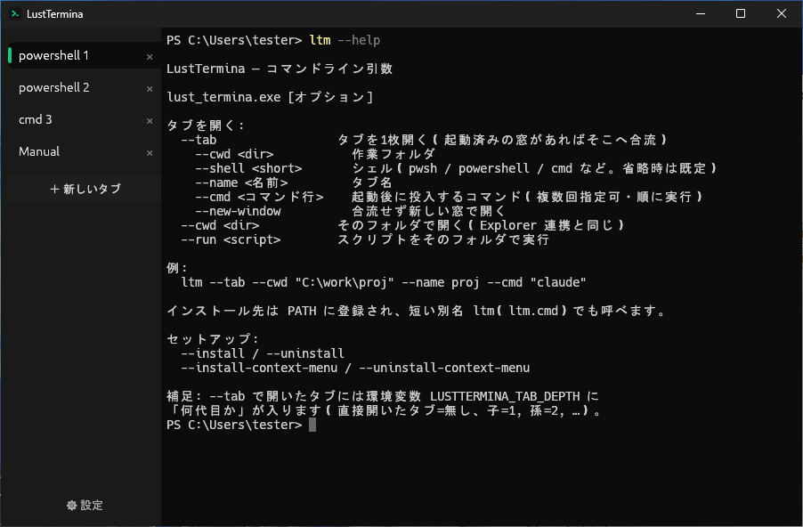

**入れ子タブの深さ** — `--tab` で開いたタブには環境変数 `LUSTTERMINA_TAB_DEPTH` が入ります（直接開いたタブ＝無し、その中から開いた子＝`1`、孫＝`2`…）。タブから更にタブを開くような連鎖でも、自分が何代目かを見分けられます。

## 既知の制限（これから）

- 選択範囲をスクロールに追従させる処理
- CJK 全角文字の幅計算（描画はされるが幅の扱いは素朴）
- イタリック表示（属性は取得するが斜体フォント面が未ロード）
- マウスレポート / 差分描画（性能最適化）
- IME のインライン変換（現状は候補ウィンドウのみ）

---

## 仕組み（開発者向け）

シェルの入出力を仮想端末(ConPTY)経由でやり取りし、端末エスケープを解釈してグリッド化、それを GPU で描画しています。

```
シェル ⇄ portable-pty(ConPTY) ⇄ alacritty_terminal(グリッド) → egui で描画
                                              ↑ 入力: egui → エンコード → pty
```

- 本体は `src/` を責務ごとに分割。`main.rs`（起動時の分岐＝CLI・インストーラ・単一インスタンス転送）／`app.rs`（アプリ状態と更新ループ）／`session.rs`（PTY と端末セッション）／`ui.rs`（描画・設定画面）／`winintegration.rs`（インストーラ・レジストリ・Win32 連携）／`config.rs`・`shells.rs`・`icons.rs`・`color.rs`・`input.rs`・`ipc.rs`。
- PTY の読み取りは別スレッドで行い、共有した端末状態を更新して再描画を要求。
- 色は 16 / 256 / truecolor、per-cell 背景色、反転・bold・dim・下線・取り消し線の属性に対応。

**主な依存：**

- `eframe` 0.35（egui 同梱、wgpu バックエンド）
- `portable-pty` 0.9（ConPTY）
- `alacritty_terminal` 0.26（VT/グリッド解釈）

## 名前について

**L**ust ×（**R**ust）の L/R 引っかけ ＋ **Termina**（terminus＝終端）。カナ「ラスト」は Lust / Rust / Last の三重掛け。

## ライセンス

[MIT](LICENSE-MIT) または [Apache License 2.0](LICENSE-APACHE) のデュアルライセンス。好きな方を選んで使えます。

アイコン表示に [Material Icons](https://github.com/google/material-design-icons)（© Google, Apache License 2.0）を同梱しています。
